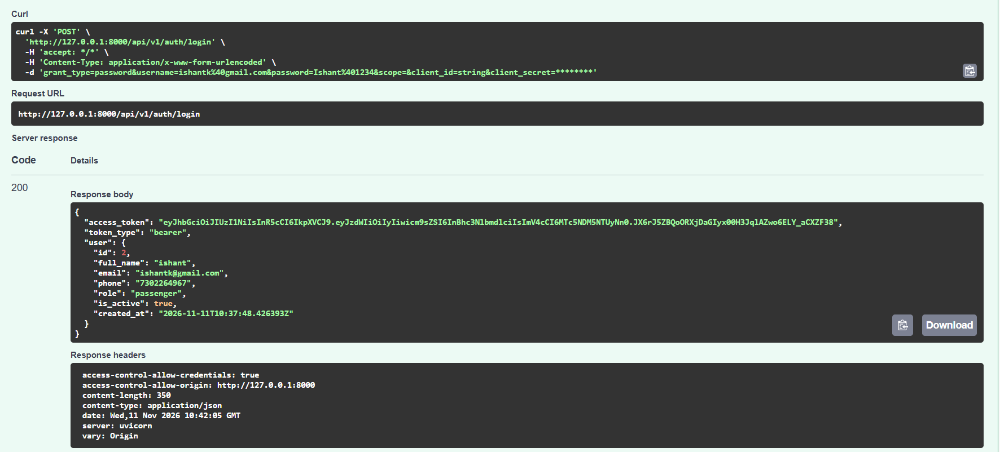

# 🚂 RailConnect — Railway Reservation System

A backend API that simulates an Indian railway ticket reservation system, built with FastAPI. This is an educational project — no real railways, payments, or IRCTC involved.

---

## 🔧 What This Project Does

- Passengers can register, login, search trains, book tickets, view bookings, and cancel tickets.
- Admins can add stations, trains, stops, seat classes, and fares.
- The system generates a unique PNR for every booking.
- Payments are simulated — no real money involved.

---

## ✨ Features Built

- JWT Authentication (register, login, forgot/reset password)
- Role-based access — Passenger and Admin
- Admin: manage stations, trains, stops, fares
- Train search by source → destination → date
- Ticket booking with unique PNR generation
- Simulated payment (Mock UPI)
- Booking cancellation with 80% simulated refund
- 37 automated tests

---

## 📦 Packages Used

```
fastapi
uvicorn
sqlmodel
pydantic
pydantic-settings
python-jose
passlib
bcrypt==4.1.3
email-validator
httpx
pytest
python-dotenv
```

---

## ⚙️ Installation Steps

```bash
# 1. Clone the repo
git clone https://github.com/YOUR_USERNAME/railconnect.git
cd railconnect

# 2. Create virtual environment
python -m venv venv

# Windows
.\venv\Scripts\Activate.ps1

# 3. Install packages
pip install -r requirements.txt

# 4. Setup environment
cp .env.example .env
# Open .env and set your SECRET_KEY
```

---

## ▶️ Run the Server

```bash
uvicorn app.main:app --reload --port 8000
```

- Swagger UI → http://127.0.0.1:8000/docs
- Health Check → http://127.0.0.1:8000/api/v1/health

---

## 🧪 Run Tests

```bash
pytest tests/ -v
```

Expected: **37 passed**

---

## 🌐 Important API Endpoints

| Method | Endpoint | Who Can Use | What It Does |
|---|---|---|---|
| POST | `/api/v1/auth/register` | Anyone | Register as passenger |
| POST | `/api/v1/auth/login` | Anyone | Login → get token |
| GET | `/api/v1/auth/me` | Logged in | View your profile |
| POST | `/api/v1/auth/forgot-password` | Anyone | Request password reset |
| POST | `/api/v1/auth/reset-password` | Anyone | Reset with token |
| POST | `/api/v1/admin/stations/` | Admin only | Add a station |
| POST | `/api/v1/admin/trains/` | Admin only | Add a train |
| POST | `/api/v1/admin/trains/{id}/stops` | Admin only | Add stops to train |
| POST | `/api/v1/admin/trains/{id}/classes` | Admin only | Add seat class + fare |
| GET | `/api/v1/trains/search` | Anyone | Search trains by route + date |
| POST | `/api/v1/bookings/` | Logged in | Book ticket → get PNR |
| GET | `/api/v1/bookings/` | Logged in | My booking history |
| GET | `/api/v1/bookings/{pnr}` | Logged in | View booking by PNR |
| POST | `/api/v1/bookings/{pnr}/cancel` | Logged in | Cancel booking |

---

## 📸 Screenshots

### 1. Signup and Login

.png)



---

### 2. Forgot Password


---

### 3. Admin Adding a Station and Train


---

### 4. Searching for a Train


---

### 5. Booking a Ticket and Receiving PNR


---

### 6. Cancelling a Booking


---

### 7. All 37 Tests Passing


---

## 🏗️ Project Structure

```
railconnect/
├── app/
│   ├── config.py
│   ├── main.py
│   ├── database/
│   │   ├── engine.py
│   │   └── init_db.py
│   ├── models/
│   │   ├── user.py
│   │   ├── station.py
│   │   ├── train.py
│   │   ├── booking.py
│   │   └── payment.py
│   ├── schemas/
│   ├── services/
│   ├── routers/
│   │   └── admin/
│   ├── dependencies/
│   └── utils/
├── tests/
│   ├── conftest.py
│   ├── test_auth.py
│   ├── test_admin.py
│   ├── test_search.py
│   ├── test_booking.py
│   └── test_cancellation.py
├── screenshots/
├── .env.example
├── .gitignore
└── requirements.txt
```

---

## 🎫 PNR Format

```
RC + YYMMDD + 6 random alphanumeric characters
Example: RC261111A3F9K2
```

---

## ⚠️ Note

- All payments are simulated — no real money is involved.
- This project is for learning purposes only.
- Never commit your `.env` file or JWT tokens.
